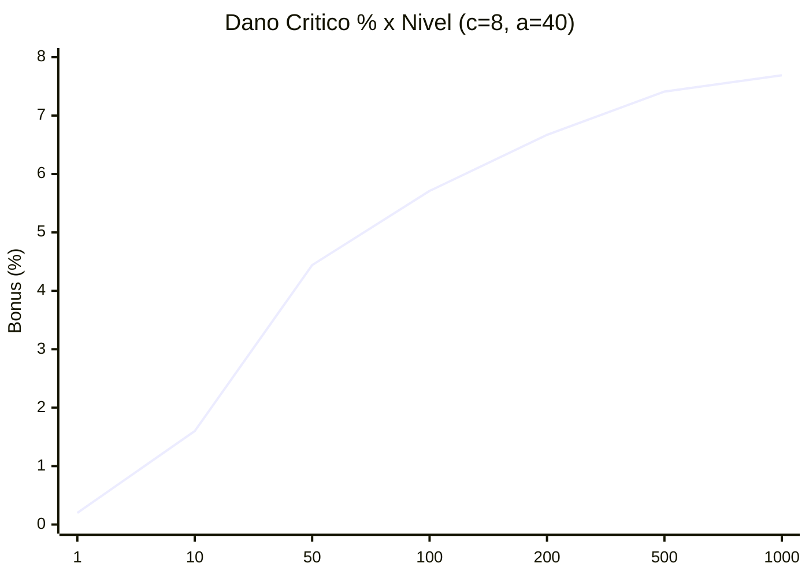
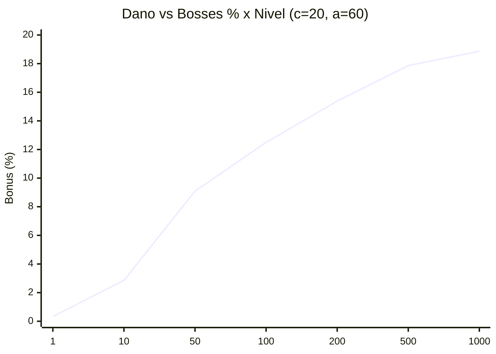
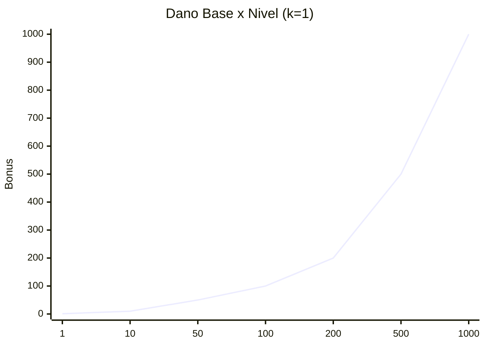

# [DATA-002] Selos: Curvas de Bônus

> Curvas de ganho de bônus por nível de selo. Ver [[DESIGN-013]].

## 1. Variáveis Base & Constantes
| Var | Descrição |
| :--- | :--- |
| `L` | nível do selo (≥ 1) |
| `k` | ganho **flat** por nível |
| `c` | teto assintótico do bônus % |
| `a` | constante de suavização (%) |

## 2. Formulação Matemática
- **Flat:** `B(L) = k × L`
- **Percentual com retorno decrescente:** `B(L)% = c × L / (a + L)` → tende a `c` quando `L → ∞`.

## 3. Schema de Configuração (JSON)
```json
{
  "id": "stamp_bonus_curves",
  "families": {
    "flat": { "formula": "k*L" },
    "diminishingPercent": { "formula": "c*L/(a+L)" }
  }
}
```

## 4. Tabela de Simulação

### Flat — Danos/Stats (`k = 1`)
| Nível | Bônus |
| :--- | :--- |
| 1 | +1 |
| 10 | +10 |
| 100 | +100 |
| 1.000 | +1.000 |

### Percentual — Dano Crítico (`c=8, a=40`)
| Nível | Bônus |
| :--- | :--- |
| 1 | +0.20% |
| 10 | +1.60% |
| 50 | +4.44% |
| 100 | +5.71% |
| 500 | +7.41% |
| ∞ | +8.00% |

### Percentual — Dano vs Bosses (`c=20, a=60`)
| Nível | Bônus |
| :--- | :--- |
| 1 | +0.33% |
| 50 | +9.09% |
| 200 | +15.38% |
| 1.000 | +18.87% |

> Formatação de exibição segue [[CONTEXT-004]] (percentuais com 2 casas). Valores `Draft` — calibrar em simulação.

## 5. Gráfico da Curva (Obsidian)

> Renderizado com **Mermaid nativo** (`xychart-beta`) — **não precisa de plugin**.
> Se sua versão do Obsidian não suportar `xychart-beta`, use o plugin **Charts** (ver nota abaixo).

### Dano Crítico (`c=8, a=40`)


### Dano vs Bosses (`c=20, a=60`)


### Flat (Linear — Dano Base, `k=1`)


> **Alternativa (plugin Charts):** instale `Obsidian Charts` e troque os blocos por:
> ````text
> ```chart
> { "type": "line", "labels": [1,10,50,100,200,500,1000],
>   "series": [{ "title": "Crit %", "data": [0.2,1.6,4.44,5.71,6.67,7.41,7.69] }] }
> ```
> ````
