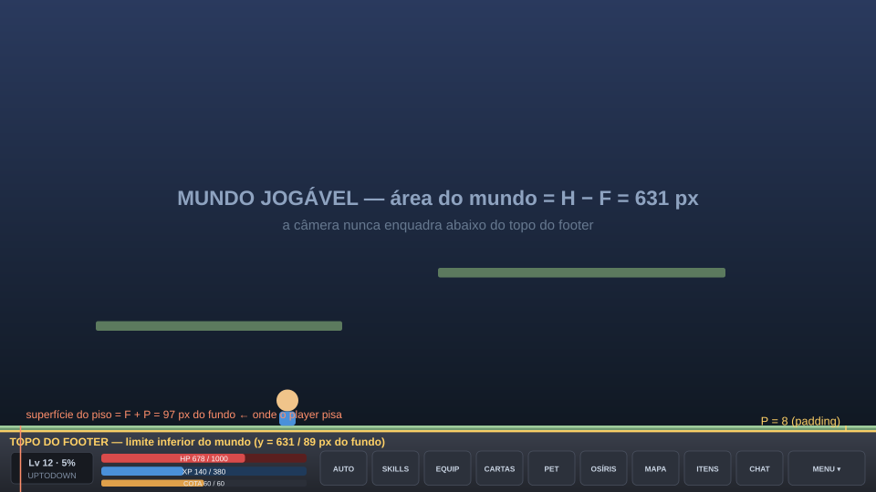

# 🖼️ Referência: UI Principal (Footer)

> Material de referência do **layout de UI**. Ver a regra em [[CONTEXT-010 UI de Jogo|CONTEXT-010]] §3b.

## 1. O que é
- **Referência externa (MapleStory):** HUD inferior com barras de **HP/MP/EXP** + **barra de ícones** de acesso aos menus, colado no fundo da tela.
- **Nosso objetivo:** algo **parecido** — **footer** fixo embaixo, largura total, com as **informações principais** (esquerda) e os **botões de menu** (direita).

## 2. Diagrama (com os nossos números)


## 3. Regra essencial (resumo)
> A **última plataforma do chão** (piso) **NUNCA** fica **abaixo do topo do footer**.
> O lugar onde o **player pisa** é **logo acima** do footer, com um **pequeno padding**.

| Constante | Valor |
| :--- | --: |
| `H` (altura base) | 720 |
| `F` (footer) | **89** px |
| `P` (padding) | **8** px |
| Área do mundo | `H − F` = **631** px |
| Superfície do piso | `F + P` = **97** px do fundo |

## 4. Print de referência (a salvar)
> ⬜ **PENDENTE:** salvar o **print do MapleStory** (o que foi enviado no chat) nesta pasta e embedar abaixo:
>
> ```markdown
> ![[nome-do-arquivo.png]]
> ```
> O print **não** foi salvo automaticamente (o anexo do chat **não** vai pro disco). Coloque o arquivo aqui e eu linko.

## 5. Relacionados
- Regra completa: [[CONTEXT-010 UI de Jogo|CONTEXT-010]] §3b · Escala: [[CONTEXT-008 Escala Visual|CONTEXT-008]].
- Layout de nível: [[DATA-006 Level Layout|DATA-006]] · Prefabs/cenas: [[SYSTEM-004 Cenas & Prefabs|SYSTEM-004]].
